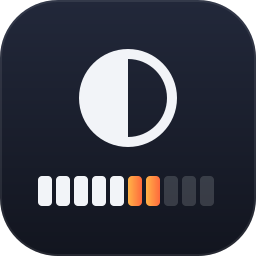
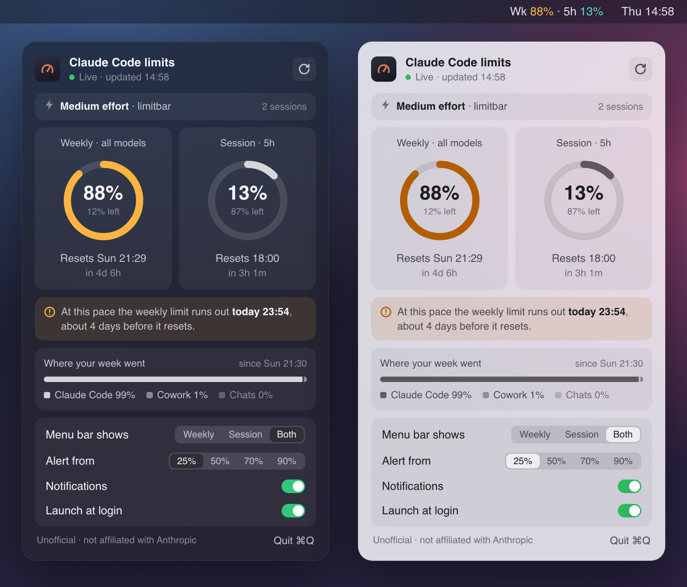
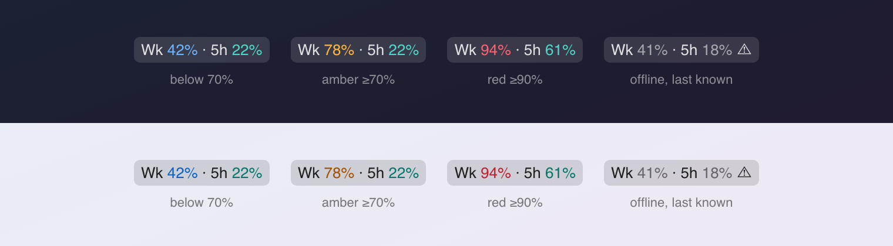
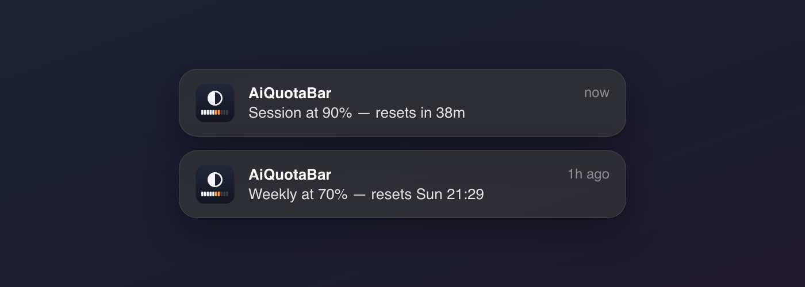

<p align="center">
  
</p>

<h1 align="center">AiQuotaBar</h1>

<p align="center">
  <b>Your Claude Code session and weekly limits, always visible in the macOS menu bar.</b><br>
  A heads-up before you hit 100%, not after.
</p>

<p align="center">
  macOS · one Python file · no dependencies · zero tokens · MIT
</p>

<p align="center">
  
</p>

Unofficial. Not affiliated with Anthropic (see [Disclaimer](#disclaimer)).

## Why

Claude Code has a 5-hour session limit and weekly limits, and you usually find out you've hit one halfway through a task. AiQuotaBar keeps the numbers one glance away and taps you on the shoulder as you get close.

| | |
|---|---|
| **Glanceable** | `Wk 77% · 5h 42%` in the menu bar: weekly in blue, the 5-hour session in teal. A number turns orange at 70% and red at 90%. Reset times are in the panel. |
| **Every limit** | Session and weekly limits as rings (plus any per-model weekly limit), each with the clock time it resets and how long until then. |
| **Pace warning** | "At this pace the weekly limit runs out Sat 14:10" when you're on track to run out before the reset. |
| **Alerts that don't nag** | At 25, 50, 60, 70 and 80%, then every 1% from 90. Each fires once per window. |
| **Effort watch** | Warns when a session has been on `high` or `max` reasoning effort for 15 minutes, which drains the session fast. |
| **Private** | One request to Anthropic's usage endpoint per minute. No analytics, no other network calls. |
| **Native** | A real macOS menu bar app (SwiftUI): opens instantly, follows light and dark mode. Built from two readable source files; no pip, no Homebrew. |

## Install

1. **Check you have:** macOS 13 or later, the Xcode Command Line Tools (`xcode-select --install`; they provide `swiftc` and `python3`), and Claude Code signed in on this Mac. No Homebrew, no other apps.
2. **Run the installer.** It builds the app on your Mac in about 10 seconds:

   ```sh
   curl -fsSL https://raw.githubusercontent.com/ankurjaiswal4/AiQuotaBar/main/install.sh | bash
   ```

   Rather read it first? `git clone https://github.com/ankurjaiswal4/AiQuotaBar.git && cd AiQuotaBar && ./install.sh`
3. **Allow two prompts.** macOS asks once for **python3** (not AiQuotaBar) to use "Claude Code-credentials": click **Always Allow** (see [First run](#first-run)). Then AiQuotaBar asks to send notifications: click **Allow**.
4. **Find it in the menu bar.** `Wk …% · 5h …%` appears at the top right within a few seconds. Click it, then turn on **Launch at login**.
5. **Update or uninstall** any time: run the same command again to update; add `--uninstall` to remove it (with the one-liner: `curl -fsSL …/install.sh | bash -s -- --uninstall`).

The installer ends with `✓ Installed AiQuotaBar 1.0.` and where the app lives (`~/Applications/AiQuotaBar.app`).

<details>
<summary>What the installer does, and its options</summary>

1. Checks for macOS 13+ and the Command Line Tools.
2. With the one-liner, downloads the source files (`aiquotabar.py`, `AiQuotaBar.swift`, the logo) and refuses to build anything that isn't AiQuotaBar.
3. Compiles `AiQuotaBar.swift` with `swiftc` and builds `~/Applications/AiQuotaBar.app`, with the engine `aiquotabar.py` inside it and the logo as its icon. The app is signed locally (ad hoc), so there's no "unidentified developer" warning: macOS only warns about apps downloaded pre-built.
4. Starts AiQuotaBar.

It's safe to run again; that's also how you update.

| Command | What it does |
|---|---|
| `./install.sh` | Install or update. |
| `./install.sh --login` | Also turn on Launch at login. |
| `./install.sh --uninstall` | Quit and remove the app and its login item. |

With the one-liner, pass options after `bash -s --`, for example `curl -fsSL …/install.sh | bash -s -- --login`.

</details>

## First run

macOS asks once: *"python3 wants to use your confidential information stored in Claude Code-credentials"*. Click **Always Allow**. That lets AiQuotaBar read the sign-in Claude Code already saved, so it can ask Anthropic for your usage.

- Checking usage costs **zero tokens** and does not count against your limits.
- Until you allow it, the menu says "Sign in via Claude Code". Allow, then click ↻ (Refresh now).
- The first run only records where you are. Alerts start from the next threshold you cross, so you don't get a pile of them on install.

## A tour

### The menu bar



| Shows | Means |
|---|---|
| `Wk 77% · 5h 42%` | Weekly · session, the default (**Both**). Choose **Weekly** or **Session** in the panel to show one. |
| `Wk 42%` in blue, `5h 42%` in teal | Below 70%. Each limit keeps its own colour so the two are easy to tell apart. |
| `78%` in amber | 70% or more. |
| `94%` in red | 90% or more. The panel shows when it resets. |
| `Wk 41% ⚠` in grey | Can't reach Anthropic right now. Showing the last known value. |
| `◌ —` | No data yet, or not signed in. |
| a trailing `⚡` | A Claude Code session has been on high reasoning effort for 15+ minutes. |

### The panel

Click the menu bar item to open the panel. It follows your Mac's light or dark mode, updates every minute and each time you open it, and has a ↻ button to refresh now.

| Part | What it shows |
|---|---|
| **Header** | **Live · updated 08:51**, or **Offline · last known from …** when Anthropic can't be reached. |
| **Effort** | Above the rings: one row per project with a Claude Code session active in the last 5 minutes, its reasoning effort, and how many sessions. Amber after 15 minutes on high effort. Hidden when none are active. |
| **Two rings** | Weekly (all models) on the left, the 5-hour session on the right: % used inside, % left under it, then when it resets ("Resets Sun 21:29") and how long that is ("in 4d 6h"). |
| **Pace warning** | Shown only when your pace so far would use a limit up before it resets: "At this pace the weekly limit runs out today 23:54, about 4 days before it resets." |
| **Other limits** | A bar for each per-model weekly limit, with % used, % left and the reset time, when Anthropic reports one. |
| **Where your week went** | How this week's usage splits across Claude Code, Chats, Cowork and so on, as reported by Anthropic. |
| **Settings** | Switches and choices, right in the panel (see below). Click anywhere on a switch's row to flip it. |

Colour means something needs attention: a limit that's fine is drawn in neutral grey, amber from 70%, red from 90%, and grey when offline.

### Alerts



- One notification per limit at **25, 50, 60, 70, 80%**, then **every 1% from 90 to 100**.
- Each fires **once per window**. When the limit resets, they re-arm.
- A **session reset** alert tells you a fresh 5-hour window has started.
- Alerts only use live data. If AiQuotaBar can't reach Anthropic, nothing fires.

No alerts showing up? Allow notifications for **AiQuotaBar** in **System Settings › Notifications**.

### Effort watch

High reasoning effort drains the session much faster, and it's easy to leave it on after the hard part is done. AiQuotaBar notices when a session has replied at `high`, `xhigh` or `max` effort for **15 active minutes**. It shows `⚡` in the menu bar and sends one notification suggesting `/effort medium`.

It reads only the time and effort level of each reply from Claude Code's local logs. It never reads message text, makes no network calls and costs no tokens. A lower-effort reply, or 10 minutes of quiet, starts the count over.

### Settings

| Setting | Choices | Default |
|---|---|---|
| Launch at login | On or Off | Off |
| Notifications | On, or Off (turning them back on doesn't replay a backlog) | On |
| Menu bar shows | Weekly, Session, or Both (weekly · session) | Both |
| Alert from | 25% (all), 50%, 70% or 90% | 25% |

Saved in `~/.aiquotabar/config.json`.

## Everyday

| Task | How |
|---|---|
| Reopen after quitting | Spotlight, type **AiQuotaBar**. |
| Quit | **Quit** at the bottom of the panel, or ⌘Q while it's open. |
| Start at login | **Launch at login** in the panel. macOS may show a one-time "Background item added" notice. That's expected. |
| Update | `cd AiQuotaBar && git pull && ./install.sh`, or run the one-liner again. |
| Uninstall | `./install.sh --uninstall`. Your settings stay in `~/.aiquotabar`; delete that folder to remove them. |

## Troubleshooting

| Symptom | Fix |
|---|---|
| "Live usage data unavailable" | A firewall (LuLu, Little Snitch, the macOS firewall) is probably blocking `python3`. Allow outbound HTTPS to `api.anthropic.com`, then click ↻ (Refresh now). Claude Code working does not rule this out: firewalls treat each program separately. Test with `python3 ~/Applications/AiQuotaBar.app/Contents/Resources/aiquotabar.py`. A `No route to host` error points at the firewall, VPN or DNS. |
| "Sign in via Claude Code" | No token found. Run `/login` in Claude Code. If the Keychain prompt appeared, click **Always Allow**. Then click ↻ (Refresh now). |
| Keychain prompt keeps coming back | You clicked Allow, not **Always Allow**. Run `./install.sh` and approve again. |
| `Wk NN% ⚠` | The last fetch failed (offline, or the endpoint returned an error). It shows the last known value. A repeated 401 means the token expired: open Claude Code once. |
| No notifications | Allow notifications for AiQuotaBar in System Settings › Notifications. Check **Notifications** is **On** in Settings and **Alert from** is low enough. Each threshold fires once per window. |
| Meter missing from the menu bar | Open **AiQuotaBar** from Spotlight. With many menu bar items, it can hide behind the notch: quit an item or two. |
| `python3: command not found` | `xcode-select --install` |

## Privacy

Everything stays on your Mac except one request: your Claude Code sign-in token goes to `api.anthropic.com` to read your usage, the same way Claude Code's own `/usage` does. AiQuotaBar never logs, prints or saves the token.

It writes only:

- `~/.aiquotabar/state.json`: percentages, reset times, which alerts already fired
- `~/.aiquotabar/config.json`: your settings
- `~/Library/LaunchAgents/local.aiquotabar.login.plist`: only if you turn on Launch at login

No analytics. Details: [SECURITY.md](SECURITY.md).

## Disclaimer

AiQuotaBar is **unofficial** and not affiliated with or endorsed by Anthropic.

- It reads the OAuth token Claude Code stored in your macOS Keychain (or `~/.claude/.credentials.json`).
- It sends that token only to Anthropic's usage endpoint at `api.anthropic.com`. That endpoint is **undocumented** and can change or stop working at any time.
- Requests carry a `claude-code/…` User-Agent, because other agents get rate-limited.
- Check Anthropic's terms for your account before you use it: [Claude Code legal and compliance](https://code.claude.com/docs/en/legal-and-compliance).
- "Claude" and "Claude Code" are trademarks of Anthropic, PBC. They appear here only to describe what AiQuotaBar works with. See [NOTICE.md](NOTICE.md).

## Contributing

Issues and pull requests are welcome. The app is two readable source files: the engine `aiquotabar.py` and the UI `AiQuotaBar.swift`. Run the tests (offline, no notifications) with `python3 -m unittest`.

## License

[MIT](LICENSE), © 2026 Ankur J: the code, documentation, logo and screenshots. Third parties and trademarks: [NOTICE.md](NOTICE.md).
